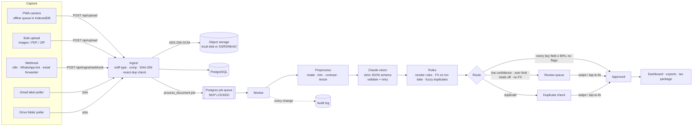
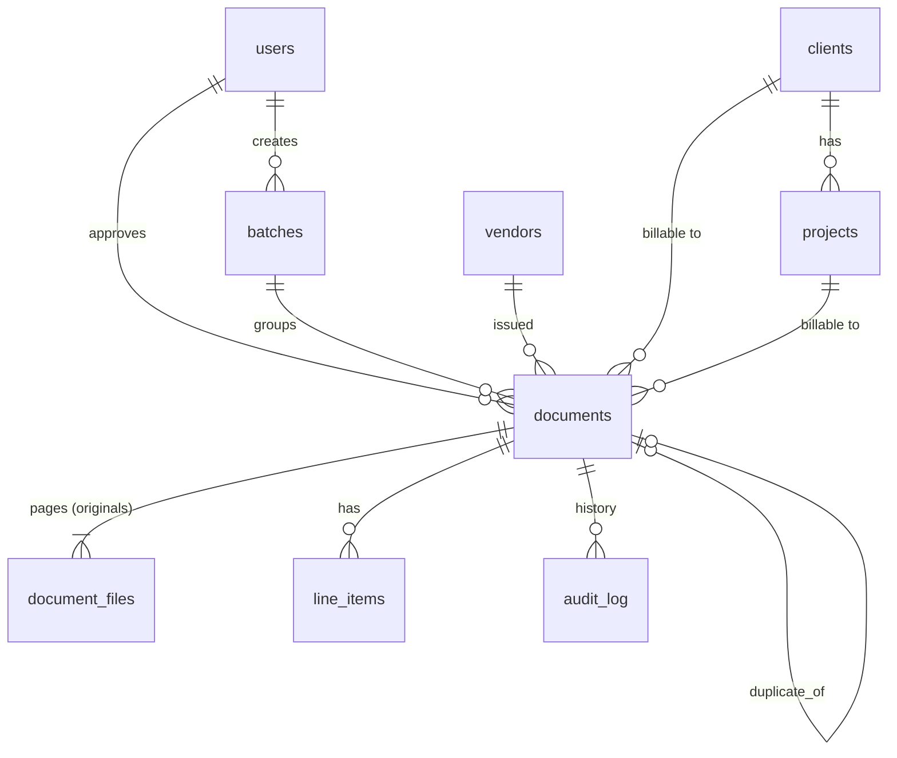

# Architecture and data model

## System diagram

One Next.js app serves the UI, the API and, by default, the queue worker (`WORKER_MODE=inline`), so one container or one VPS runs everything. Running more replicas is safe: jobs are claimed with `FOR UPDATE SKIP LOCKED`.

### Stack choices (and why they differ from the brief, where they do)

| Brief | Built | Why |
|---|---|---|
| Next.js + Tailwind, PWA | Next.js 16 (App Router) + Tailwind 4, hand-written service worker | As suggested. No PWA plugin: the offline need is narrow (open Capture, queue photos), so a 40-line worker is easier to audit. |
| Node or FastAPI | Node / TypeScript in the same Next app | One language and one deployable; the AI call is I/O-bound so Python brings no advantage. |
| PostgreSQL / Supabase | PostgreSQL via Drizzle ORM; **embedded PGlite** when `DATABASE_URL` is empty | Same SQL and migrations in demo and production; demo mode needs zero setup. Supabase works as a plain Postgres URL. |
| Queue-based workers | Postgres table queue | No Redis to run or pay for. Hundreds of documents per session is far below where a dedicated broker helps. |
| OCR + LLM | Claude vision only | Claude reads Urdu, handwriting and faded thermal paper directly; Tesseract is weak on all three and would add a second error source. |
| S3, encrypted at rest | App-level AES-256-GCM on every file **plus** S3 SSE | Files are encrypted before they leave the process, so even a leaked bucket or a disk image reveals nothing. |
| Email + 2FA | Email/password (scrypt) + TOTP, signed HTTP-only session cookie | No third-party auth service needed; works with any authenticator app. |

## Data model

| Table | Purpose | Key columns |
|---|---|---|
| `users` | Owner and (later) accountant accounts | `role` owner/accountant, `totp_secret_enc` (encrypted), `session_version` (revokes sessions) |
| `documents` | One receipt/bill/invoice: the editable current truth | status, extracted fields, `total` + `currency` (original) and `total_usd` + `fx_rate` + `fx_date`, `field_confidence` (per field), `overall_confidence`, `review_reasons`, `duplicate_of_id`, `raw_extraction` (model output as received), `archived_filename`, `retain_until`, `sha256` |
| `document_files` | Every page, encrypted, never modified | `storage_key`, `sha256`, `mime_type`, `page_no` |
| `line_items` | Lines from the receipt | description, quantity, unit price, amount |
| `vendors` | Canonical vendors + **learned rules** | `normalized_name` (unique), `default_category`, `default_is_business`, `default_client_id` |
| `clients`, `projects` | Who expenses are billable to | name, code |
| `batches` | A backlog session (e.g. "Backlog 2024 shoebox") | name, source |
| `fx_rates` | Cached daily USD rates (PKR, AED, GBP, EUR, …) | `rate_date`, `currency`, `per_usd`, `source` |
| `audit_log` | Append-only: who/what changed what, when, from where | `actor_type` user/system/ai, `action`, `changes` (field-level from→to), `ip` |
| `jobs` | Work queue | type, payload, attempts, `run_at` (backoff), `last_error` |
| `ingest_state` | Gmail/Drive poll bookkeeping | `last_run_at`, `cursor` |
| `settings` | Routing thresholds, retention, accounting basis, digest/reminder preferences | JSON |
| `ledger_entries` | Approved business transactions, append-only | `entry_date`, `kind` expense/revenue, `category`, `amount` + `currency` (original), `amount_usd`, `fx_rate`, `client_id`, `reversal_of`, `reversed` |
| `webhook_endpoints` | Outgoing webhooks (n8n/Zapier) | `url`, `secret` (encrypted), `events`, `last_status` |
| `ai_batches` | Economy-mode submissions to the Message Batches API | `anthropic_id`, `document_ids`, `status` |

Payment tracking lives on `documents` (`paid_at`, `paid_amount`, `payment_ref`, `reminded_at`), as does re-billing (`rebilled_at`) and economy mode (`economy`, `ai_batch_id`).

| `statements` | Imported bank/card statements (CSV, or PDF/photo read by Claude); original kept encrypted | `currency`, `account_last4`, `period_start/end`, `source_format` |
| `bank_transactions` | One row per statement line | `txn_date`, `amount` (negative = out), `fingerprint` (unique: overlapping imports don't duplicate), `match_status`, `document_id`, `match_score` |
| `invoices`, `invoice_lines` | Outgoing invoices; lines can point at the re-billed expense | `number` (unique, PREFIX-YYYY-NNN), `status` draft/issued/void, `document_id` (its sales-invoice record) |
| `counters` | Atomic, gap-free invoice numbering per prefix and year | `key`, `value` |

### Bank matching

Each pair of open transaction and candidate document gets a score = 0.5 × amount + 0.25 × date + 0.25 × name.
- **Amount:** exact in the same currency = 1. Within 3% = 0.7. A meal charged up to 20% more = 0.45 (tip added on the card slip). A foreign-currency receipt on a USD card is compared with its USD conversion: within 3% = 0.8, within 6% = 0.55 (bank FX markup).
- **Date:** receipts allow −2 to +10 days (cards post late). Bills and invoices allow anything from the issue date to 3 weeks past due.
- **Name:** the share of the vendor's name words found in the bank narration.

Pairs are assigned greedily from the best score, so each transaction and each document is used once. **Auto-match** needs a score of at least 0.85 and a lead of 0.1 or more over the runner-up for both sides; anything from 0.55 is only **suggested** (one tap to confirm). Matching a bill or sales invoice marks it paid on the transaction date, which posts it to the ledger on the cash basis. Gaps are flagged in both directions: charges with no receipt, and card/bank-paid receipts inside an imported period that no transaction accounts for.

### Invoices

Draft → **Issue** assigns the next number, freezes the PDF as an encrypted original, and creates an approved `sales_invoice` document. That puts it in receivables, the ledger (on payment under cash basis) and the tax package. It also marks the re-billed expenses as invoiced. **Void** rejects that document (reversing the ledger) and frees the expenses. Numbers are never reused.

### Ledger rules

- Only **approved business** receipts, vendor bills and sales invoices post. Personal, rejected, duplicate, bank statements and contracts don't.
- Receipts post on their date. Bills and invoices post on the **paid date** (cash basis, default) or the **document date** (accrual), chosen in Settings.
- Postings are never edited. Editing an approved document, rejecting it or re-reading it **reverses** the live entry (a negative mirror, original struck through) and posts the new one, so every past report can be reconstructed.

### Events (outgoing webhooks)

`document.processed`, `document.approved`, `document.needs_review`, `bill.due_soon`, `bill.paid`, `invoice.paid`, `digest.weekly`. Each delivery is a queued job (6 attempts with backoff) signed with HMAC-SHA256.

### Document lifecycle

`queued → processing → approved | needs_review | duplicate | failed`, and from review: `approved | rejected`. Nothing is ever deleted: rejected documents and their originals are kept until `retain_until` (Dec 31 of the document year + retention years, default 7).
